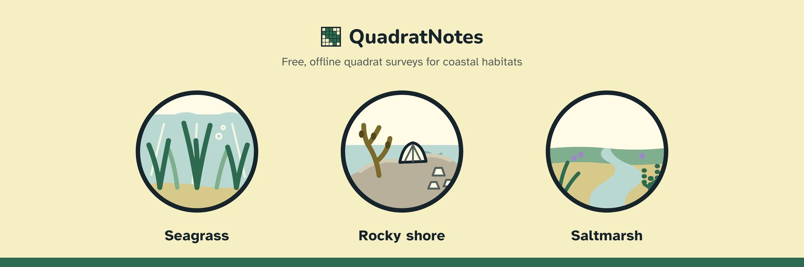

# QuadratNotes

**Free, offline quadrat surveys for coastal habitats: seagrass, rocky shore and saltmarsh.**

QuadratNotes is a free, open-source app for recording quadrat surveys on a phone or tablet,
built by a marine biologist for coastal fieldwork. It works without signal, keeps everything on
the device, and exports tidy data ready for analysis and for biodiversity databases.

**Open the app: https://quadratnotes.com**

> QuadratNotes is an early version being field-tested. Please back up or export your data after
> each survey. If you'd like to help test it, or you spot a problem, email hello@quadratnotes.com.

## Getting started
1. Open https://quadratnotes.com on your phone or tablet while you have signal.
2. Add it to your home screen (iPhone/iPad: Share, then Add to Home Screen; Android: the browser
   menu, then Install app). It then opens like an app and works offline.
3. Choose a habitat, start a survey and record quadrats. Back up or export when you're done.

## What it records
- **Seagrass:** cover with a tap-the-squares grid, species, shoot counts and density, canopy
  height, epiphytes, algae and sediment.
- **Rocky shore:** seaweed and sessile animal cover in canopy and understorey layers, counts of
  limpets, topshells and other mobile animals, shore zone, height and substrate.
- **Saltmarsh:** plant cover with Domin classes, bare ground, litter, vegetation height and grazing.
- **Every survey:** site, date, surveyor, quadrat size, sampling design, GPS position and accuracy,
  photos, notes, and optional weather and modelled tide from Open-Meteo.

## Features
- **Works offline:** records in the field without signal, with data stored only on the device.
- **Grid estimator:** tap the squares a species covers (each is 4%); squares are saved and exported.
- **Random sampling (optional):** draw or walk the survey area, place random points with an optional
  minimum spacing, and get guided to each one. Skipped points and reasons are recorded.
- **Fixed points (optional):** for monitoring or restoration plots revisited over time. Mark each
  plot where you stand (GPS is averaged for 20 seconds), tap the map, import a file, or copy the
  points from an earlier survey of the site, then get guided to each one. Point names stay the
  same from visit to visit, so data lines up across years on `point_id`.
- **External GPS:** accuracy is kept to the centimetre, so GNSS, DGPS and RTK receivers set up as the
  device's location source are captured properly.
- **Backup and restore:** one file holds every survey, quadrat and photo. Restoring adds data
  without overwriting it, so it also combines surveys recorded on several phones.

## Exports
- Quadrat and species tables (CSV). The quadrats table has one row per quadrat: location, time,
  conditions and habitat details. The species table has one row per species per quadrat, with
  cover, layer, counts, shoots and canopy heights as recorded. Join them in R on `quadrat_id`.
- Photos, named by site, date and quadrat, in a zip with the tables. Each photo carries its
  quadrat's location, time and species list (EXIF), so it can be dragged straight into the
  iNaturalist web uploader.
- Map files: GeoJSON (QGIS, ArcGIS, R) and KML (Google Earth), including the survey area,
  random points and fixed points if used.
- Points tables: `_random_points.csv` and `_fixed_points.csv`, with each point's status, skip
  reason and linked quadrat. A fixed points file can be imported into a later survey.
- A Darwin Core archive for sharing with OBIS and GBIF.

### Importing fixed points
CSV with `point_id`, `latitude` and `longitude` columns in decimal degrees (WGS 84, e.g.
`52.87123, -4.61234`), GeoJSON points or KML placemarks. Shapefiles and British National Grid
coordinates aren't read directly: in QGIS, save the layer as GeoJSON or KML with CRS
EPSG:4326 (WGS 84), then import that. Phone GPS is usually accurate to 3–10 m, so for plots that
must be found to the centimetre use a physical marker or an RTK receiver.

GPS height is exported raw (`gps_altitude_m`, `gps_altitude_accuracy_m`). Its reference level
depends on the device and receiver (often the WGS84 ellipsoid, not sea level or chart datum), and
phone heights are usually only good to ±10–30 m, so convert and check them before use.

## Privacy
No accounts, no tracking and no analytics. Survey data never leaves the device unless you export
it. If you tap "Get current conditions", an approximate location (to about 1 km) is sent to
Open-Meteo for the weather and tide; map tiles come from OpenStreetMap when the map is used. Feedback sent
from the app's field-testers note goes through Web3Forms to hello@quadratnotes.com and contains only the
optional 1–5 rating, what the person types and the app version.

## Feedback and contributing
Bug reports and suggestions are welcome as GitHub issues, or by email to hello@quadratnotes.com.

## How to cite
Thomas, O. R. (2026). *QuadratNotes* [Computer software]. Zenodo.
https://doi.org/10.5281/zenodo.24295028

The DOI always points to the latest version; each release also has its own version DOI on Zenodo.
GitHub's "Cite this repository" button gives the citation in other formats.

## Licence
Copyright (c) 2026 Oliver R Thomas. The code is released under the MIT License (see `LICENSE.txt`).

### Name and logo
The MIT License covers the code only. The QuadratNotes name, logo and habitat artwork are
(c) 2026 Oliver R Thomas, all rights reserved, and may not be used to name or brand other products
without permission. If you fork the project, please use a different name and icon.

### Third-party code, data and fonts
- `jszip.min.js`: JSZip 3.10.1 (https://stuk.github.io/jszip/), dual-licensed MIT or GPLv3.
- `leaflet/`: Leaflet 1.9.4 (https://leafletjs.com), BSD 2-Clause licence (see `leaflet/LICENSE.txt`).
- Map tiles: © OpenStreetMap contributors (https://www.openstreetmap.org/copyright), ODbL, loaded from
  tile.openstreetmap.org under the OSM Foundation tile usage policy; the app does not store them for offline use.
- Point-in-polygon test after PNPOLY by W. Randolph Franklin (MIT-style licence); Mulberry32
  random number generator by Tommy Ettinger (public domain).
- Atkinson Hyperlegible, Barlow Condensed and Nunito fonts: SIL Open Font License 1.1 (see `fonts/`).
- Weather and modelled tide data: Open-Meteo.com (CC BY 4.0).
